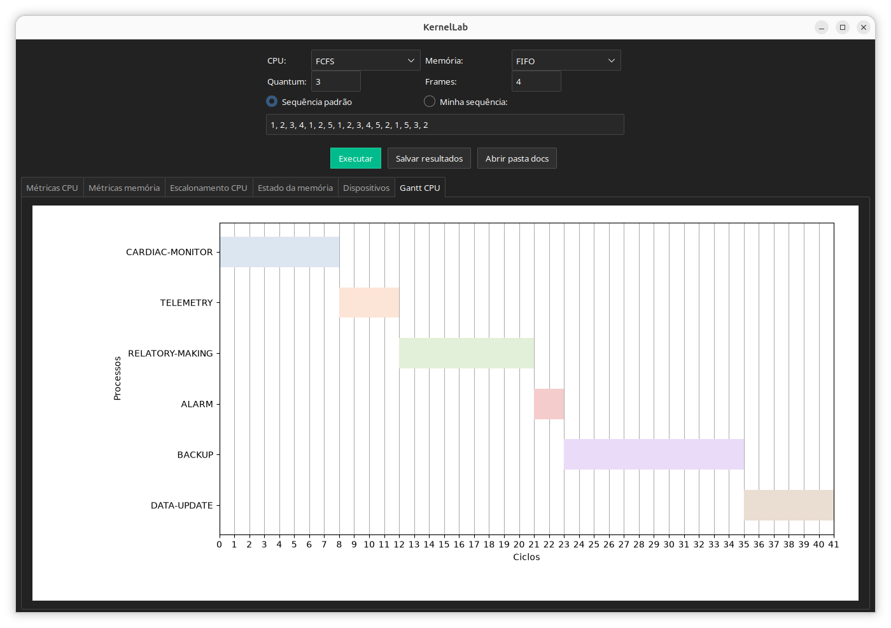

# KernelLab

O KernelLab é um simulador didático de CPU, memória e dispositivos, baseado no cenário da empresa fictícia MedControl Systems. Ele mostra como tarefas de monitoramento, alarme, telemetria, relatórios e backup disputam os mesmos recursos do computador.

> O simulador é educacional e não garante prazos de tempo real.

## Como executar

1. Instale o Python 3.11 ou superior (com Tkinter).
2. Instale as dependências: `pip install -r requirements.txt` (pandas, ttkbootstrap, matplotlib e openpyxl).
3. Inicie a aplicação: `python app.py`.

## Interface

Na imagem, a CPU usa o algoritmo FCFS e a memória usa o FIFO. O quantum (fatia de tempo da CPU) está em `3` e há `4` frames (os espaços da RAM que recebem páginas).

- **Executar:** roda a simulação e atualiza as abas de métricas, escalonamento, memória, dispositivos e Gantt.
- **Salvar resultados:** exporta as tabelas e o gráfico para uma planilha Excel na pasta `docs/`.

## Exemplo de uso e conferência

1. Mantenha FCFS, FIFO, quantum `3`, `4` frames e a sequência padrão de páginas.
2. Clique em **Executar**.
3. Na aba **Gantt CPU**, confira a ordem mostrada na imagem: cardiac-monitor, telemetry, relatory-making, alarm, backup e data-update. A execução termina no ciclo 41.
4. Na aba **Métricas memória**, confira os 17 acessos à sequência de páginas. O FIFO deve apresentar 5 acertos (página já estava na memória) e 12 faltas (página precisou ser carregada), ou seja, 70,59% de faltas.
5. Clique em **Salvar resultados** para guardar as tabelas e o gráfico em Excel.

Depois, troque o algoritmo ou altere quantum, frames e sequência de páginas para observar como os resultados mudam.

## O que é simulado

**Escalonamento da CPU** (define quem usa a CPU e quando):

- **FCFS:** executa os processos por ordem de chegada.
- **SJF:** prioriza os processos com menor duração de CPU.
- **Round Robin:** divide a CPU em intervalos chamados quantum; o valor inicial é `3`.
- **Prioridade:** considera mais prioritários os processos com menor número.

**Substituição de páginas** (define qual página sai da memória quando ela está cheia):

- **FIFO:** remove a página mais antiga.
- **LRU:** remove a página menos usada recentemente.
- **Optimal:** remove a página que demorará mais para ser usada de novo. Serve como referência teórica, pois exige conhecer o futuro.

**Dispositivos:** o simulador confere as permissões e organiza as solicitações em filas. Um processo com acesso exclusivo espera até poder ocupar todos os dispositivos que pediu. A tabela agrupa ciclos consecutivos e mostra início, fim, ciclos de execução e ciclos com pedidos aguardando.

## Dados e organização

Os arquivos JSON da pasta `data/` definem processos, páginas, dispositivos e permissões.

- **Processo:** `id`, `name`, `arrival` (chegada), `burst` (duração de CPU), `priority` (prioridade), `memory` e `devices`.
- **Permissão:** `process`, `device` e `permissions`, com valores como `read`, `write` e `exclusive_access`.
- Os nomes dos dispositivos devem ser iguais em todos os arquivos.

Arquivos do código:

- `app.py`: inicia a aplicação.
- `view/ui.py`: contém a interface.
- `src/schedulers.py`, `src/memory.py`, `src/devices.py` e `src/metrics.py`: implementam os algoritmos e os cálculos.
- `src/main.py`: coordena a simulação.

O relatório teórico está em [`docs/Relatorio_Teorico_KernelLab.pdf`](docs/Relatorio_Teorico_KernelLab.pdf).

## Limitações

- **Ordem fixa:** o escalonamento define a ordem dos processos de uma só vez. SJF e Prioridade não escolhem entre os processos à medida que eles chegam, e o Round Robin começa com todos na fila.
- **Métricas de CPU:** todos os processos são tratados como prontos no ciclo zero, e a chegada (`arrival`) não é descontada dos tempos.
- **Uma política por vez:** a interface executa um algoritmo de cada vez.
- **Memória:** a sequência de páginas é independente da memória indicada para cada processo.
- **Dispositivos:** as filas avançam em ciclos de simulação e não representam tempo real de espera.
